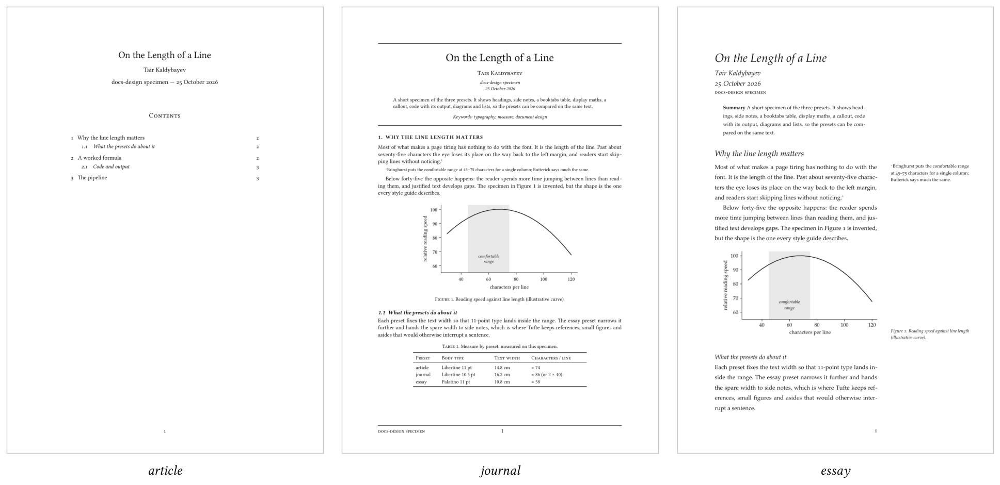
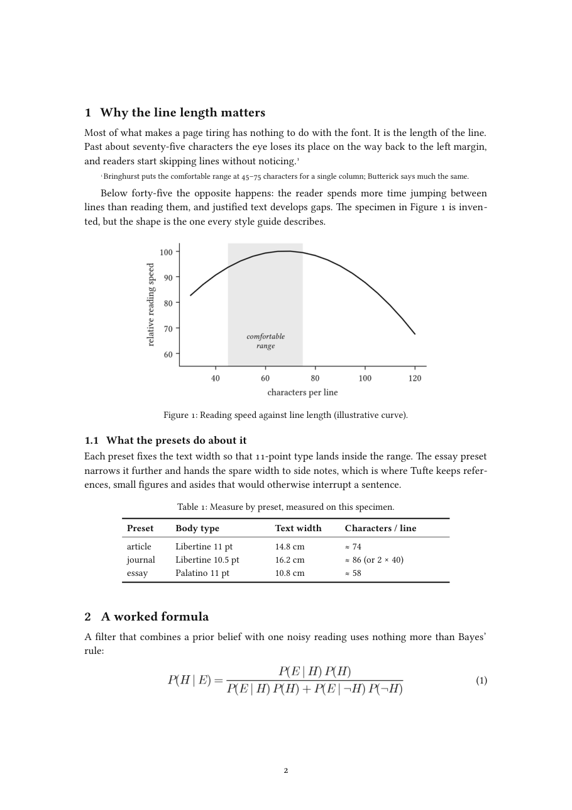
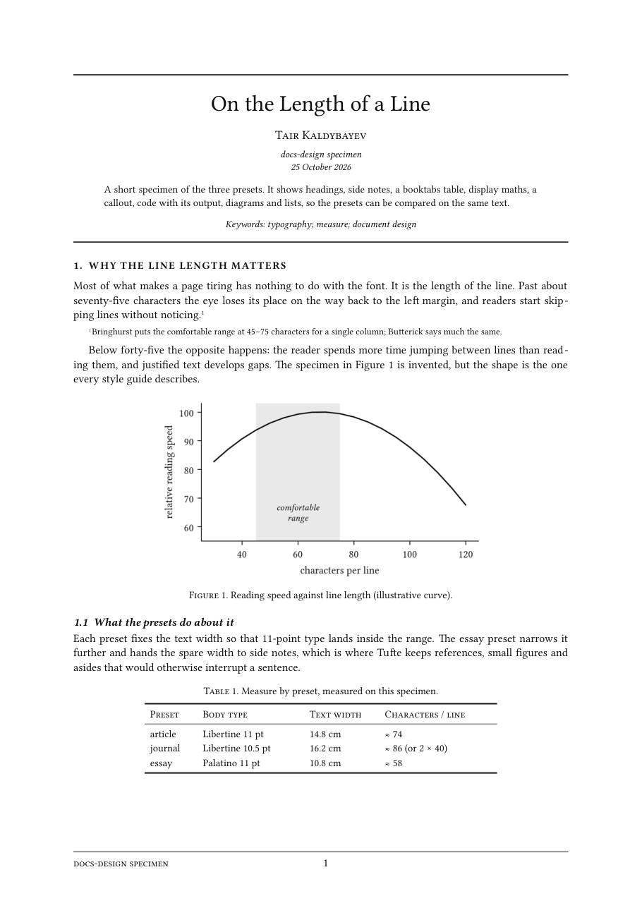
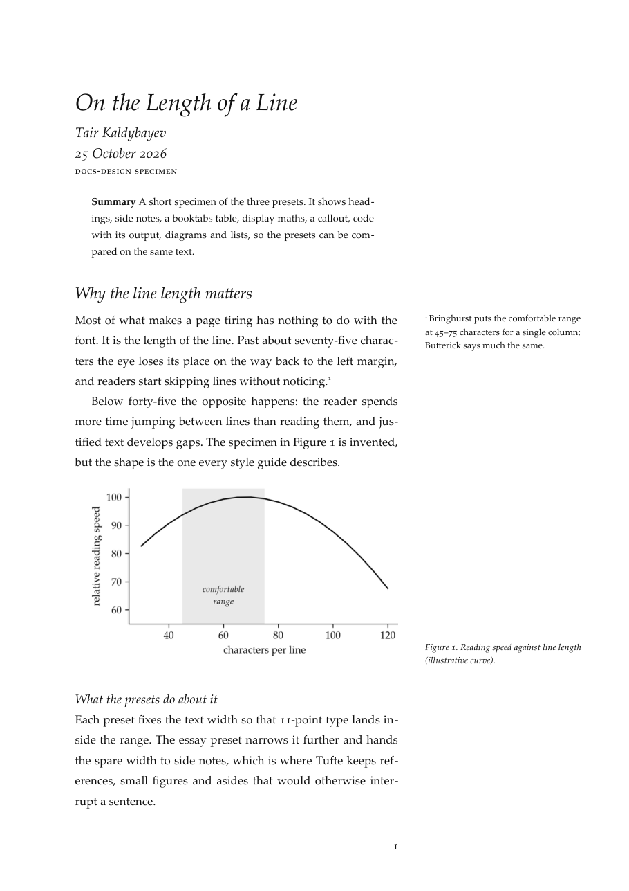
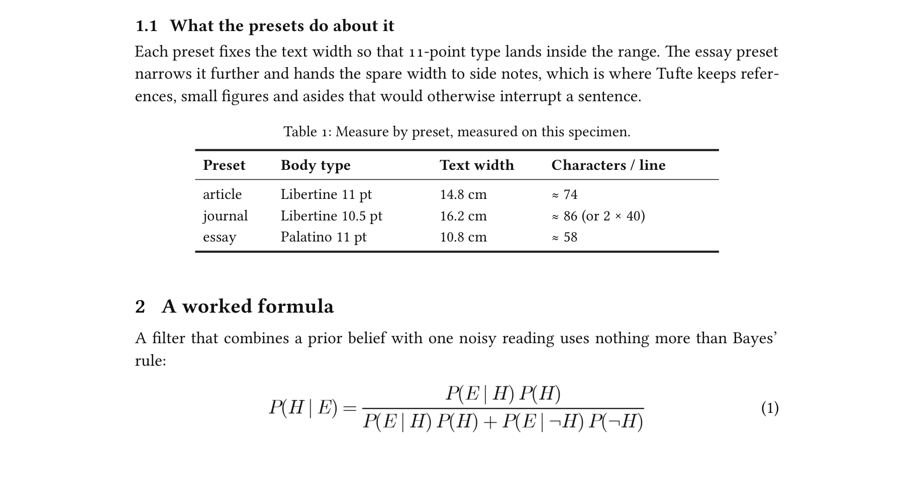
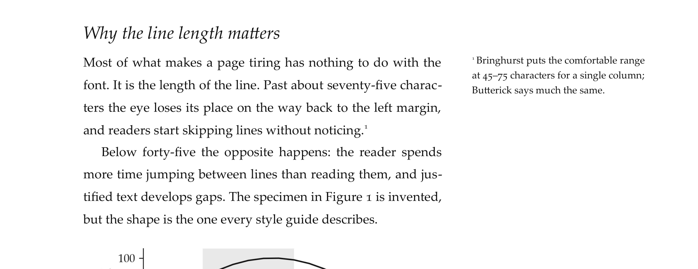
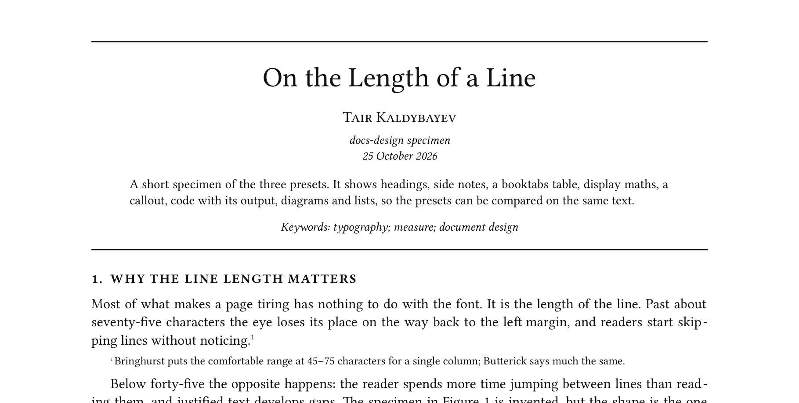

# docs-design

A skill for AI agents that turns "write this up" into a document that looks typeset. You get
LaTeX-quality pages from a plain Python script, and text that doesn't read like a chatbot wrote it.



Most AI-generated documents give themselves away within a second: Calibri, blue headings, grey
grid tables, a bullet list where a sentence would do, and a closing paragraph that summarises the
paragraphs above it. This skill gives the agent a small layout library with three classical
presets, plus two short guides it has to follow: one on typography and one on writing like a
person. The output is a PDF you can hand in or send, with an editable DOCX alongside it.

## Use it with any AI agent

Paste the link and the task. That's it:

```text
Use the docs-design skill from https://github.com/tairqaldy/docs-design-skill
Clone it, read SKILL.md and follow it: write the text by its writing guide, build the document
with scripts/tairdoc.py using the preset that fits, render the PDF and check every page before
you give it to me.

Task: <what you need, plus any files>
```

This works with any agent that can run Python and shell commands (Claude Code, Codex, Cursor,
and others).

### Install as a permanent skill (Claude Code)

```bash
git clone https://github.com/tairqaldy/docs-design-skill ~/.claude/skills/docs-design
```

On Windows (PowerShell):

```powershell
git clone https://github.com/tairqaldy/docs-design-skill "$HOME\.claude\skills\docs-design"
```

After that, Claude picks it up on its own whenever you ask for a report, an assignment write-up, a
handout or a PDF. You don't have to name it.

### Requirements

- Python 3.9+ and `pip install -r requirements.txt` (python-docx, matplotlib, Pillow, PyMuPDF)
- [LibreOffice](https://www.libreoffice.org/download/) for the PDF export. It also bundles Linux
  Libertine, the main typeface.
- The essay preset uses Palatino: Palatino Linotype on Windows, Palatino on macOS, TeX Gyre
  Pagella or URW P052 on Linux. Whichever is installed gets picked.

## The three presets

| | | |
|:---:|:---:|:---:|
| [](examples/out/specimen_article.pdf) | [](examples/out/specimen_journal.pdf) | [](examples/out/specimen_essay.pdf) |
| **`article`**: LaTeX's article class. Centred title, numbered bold headings, Libertine with Computer Modern maths. For assignments, lab reports and technical write-ups. | **`journal`**: an old-school paper. Title between hairlines, small-caps author, abstract and keywords, letter-spaced section heads, running footer. For research and reviews. | **`essay`**: a Tufte handout. Italic title block, Palatino, a wide margin for side notes and figure captions. For essays, notes and explainers. |

Click a page to open the full specimen PDF.

## Up close

The details are what make a page read as typeset: real small caps, old-style figures in running
text, booktabs tables with three rules and nothing else, display maths in Computer Modern
with the equation number flush right, and side notes that sit next to the line they belong to.







## What the library gives you

```python
import sys; sys.path.insert(0, "path/to/docs-design/scripts")
from tairdoc import Doc, Diagram, mpl_style, render_terminal

d = Doc("Lab 3: Heat Transfer", author="Jane Doe", affiliation="Physics 201",
        date="12 March 2026", theme="article")
d.section("Method")
d.para("We heated the rod for 300 s.^[Thermocouple calibrated the day before.]")
n = d.equation(r"q = -k\,\frac{\mathrm{d}T}{\mathrm{d}x}")
t = d.table([["Run", "ΔT (K)", "q (W/m²)"], ["1", "12.4", "830"], ["2", "12.9", "861"]],
            caption="Measured heat flux.")
d.para(f"Table {t} agrees with equation ({n}) to within 4%.")
d.callout("Run 2 was taken after the room warmed by 1 K.", kind="note")
d.save("Doe_Jane_Lab3.docx")   # writes the .docx and the .pdf
```

It also covers figures, side notes, code listings, rendered program output, block quotes, lists, a
contents page with real page numbers, and TikZ-style diagrams (`Diagram`). Matplotlib plots
pick up the same fonts through `mpl_style()`. The full reference is in [SKILL.md](SKILL.md).

## What it makes the agent do

The layout is half of it. The skill also makes the agent:

- **Write in a human voice.** [references/writing.md](references/writing.md) bans the usual tells
  ("delve", "it's important to note", em dashes everywhere, three-item lists, closing summaries)
  and asks for the answer first, real numbers, and prose over bullets.
- **Follow the typographic rules.** [references/design-guide.md](references/design-guide.md)
  explains them, drawn from Bringhurst, Butterick, Tufte and LaTeX's defaults: a 45–75 character
  measure, hierarchy without colour, no grid tables.
- **Look before handing it over.** The agent renders every page and fixes split tables, stranded
  headings and one-line last pages before you see the file.
- **Leave unknowns visible.** It never invents a name, group or date; it leaves a blank instead.

## Repository layout

```text
SKILL.md                  instructions the agent follows
scripts/tairdoc.py        the layout library
references/               design and writing guides
examples/showcase.py      builds one specimen per preset (also the regression test)
examples/out/             the specimen PDFs
docs/                     README images and the script that makes them
```

To rebuild the examples after changing the library:

```bash
python examples/showcase.py
python docs/make_screenshots.py
```

## Credits

Built by [Tair Kaldybayev](https://github.com/tairqaldy). The presets are modelled on LaTeX's
`article` class, *The Computer Journal*, book contents pages set in Garamond, and Edward Tufte's
handouts. MIT licence.
